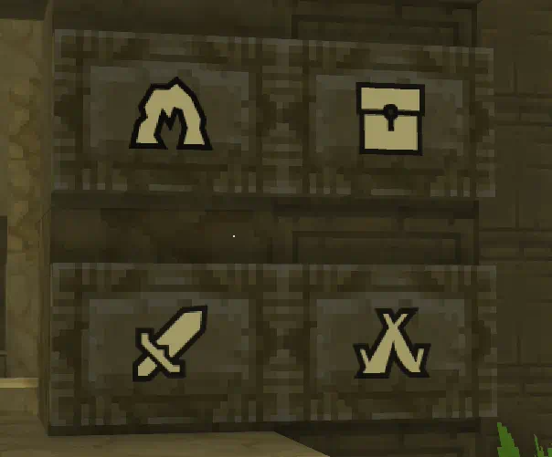

# Postly
The simple sign system

### Editing Signs

Postly allows for simple editing of sign text and mutation of the icons

### Custom Icons

Icons can be taliored to your needs
(plus it adds support for wall signs)

### Works on multiple sign variants

Postly works on most* default hytale signs. 